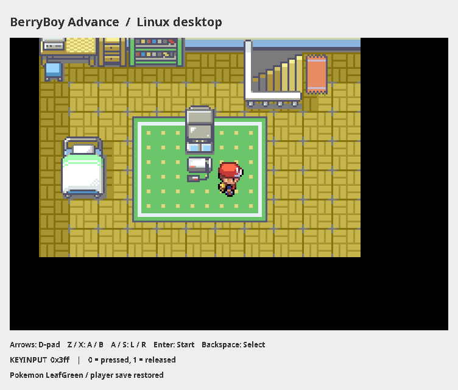

# BerryBoy Advance — 0.6

An experimental GBA emulator for classic BlackBerry devices, targeting the Bold
9900 and BBOS 7.1. Development runs on **Linux, Java 21 and Maven**. The core
executes ARM/Thumb instructions and renders local games with a software PPU.
Commercial-game accuracy and BlackBerry runtime compatibility remain under validation.

## Changes in 0.6

The desktop session now forwards all ten GBA buttons, including simultaneous
presses and focus-loss release. The portable core provides four PSG channels and
timer/DMA-fed Direct Sound A/B, sampled on the shared guest clock. The desktop
drains bounded PCM buffers and presents completed raster frames with absolute
cycle pacing. A separate diagnostic audio demo exports a WAV file or plays it
through Java Sound. Hardware sequencer/PWM edge cases and device output remain
unverified.



Pokemon LeafGreen after loading a player save. The game frame matches mGBA
pixel for pixel at this checkpoint. This is the application's desktop component
painted headlessly from the recorded frame. See [capture provenance and reproduction](docs/AUDIO-INPUT.md#application-captures)
and [current game-validation limits](docs/REFERENCE-VALIDATION.md).

The legacy exporter now resolves only explicitly supplied sources and protects
handwritten files in its output directory. Export tests live in the build package;
the repeated core suite cannot fall back to the host's compiled core classes.

All host test assertions now use **AssertJ Core 3.27.7**. JUnit Jupiter 5.13.4
still discovers and runs the tests through Maven Surefire. Fluent assertions
cover values, exceptions and diagnostic messages; `assertSoftly` reports related
register and flag failures together. AssertJ and JUnit remain test dependencies.

All Markdown documentation is in English. `AGENTS.md` records the development
conventions and the requested commit-and-push workflow for future updates.

The Java 21 CLI uses a sealed command interface, records and record patterns.
The core separates CPU state, ARM/Thumb decoders, arithmetic and shifting.
Review the source changes through Git history.

## Getting started on Linux

Install JDK 21 and Maven 3.9.x. Maven must run on JDK 21; check `mvn -v` and set
`JAVA_HOME` to your JDK 21 installation if needed. Maven is the maintained build
entry point on Linux; there is no second Gradle build to keep in sync.

```bash
mvn test                       # JUnit 5 tests with AssertJ assertions
mvn verify                     # Tests and application JAR
mvn compile exec:java          # Demo with a desktop window
```

Run without a window:

```bash
mvn compile exec:java -Dexec.args="demo --headless"
```

The outputs are `target/demo.png` and `target/demo.gba`. The demo executes
200,000 instructions: ARM configures the bitmap display, BX enters Thumb, and a
loop writes 38,400 pixels through the memory bus. Execution ends in a loop at
`0x080000FA`. The original demo ROM has a development header without the Nintendo
logo. It tests direct cartridge entry, rather than booting through the original BIOS.

```bash
mvn compile exec:java -Dexec.args="header /path/to/file.gba"
mvn compile exec:java -Dexec.args="run /path/to/homebrew.gba 200000 --headless"
mvn compile exec:java -Dexec.args="audio-demo --headless"
```

`run` is a diagnostic tool. Unsupported hardware or opcodes stop execution.
Without `--headless`, the desktop window continues execution and shows live
`KEYINPUT`. Use arrows, Z/X for A/B, A/S for L/R, Enter for Start and Backspace for
Select. The original visual demo remains static and silent; `audio-demo` tests
the sound path independently. Omit its `--headless` option to request playback.

## Tests

```bash
mvn -Dtest=ArmArithmeticTest test
mvn -Dgroups=core test
mvn -Dgroups=build test
mvn -Dgroups=desktop test
```

Surefire writes reports to `target/surefire-reports`. The standard suite includes
`LegacyCoreTest`: it exports the whole core, compiles the generated sources and
runs eight portable checks in an isolated classloader. No BlackBerry SDK is
needed for these host tests.

`./test.sh` delegates to `mvn verify`. For the full suite followed by all `core`
tests against the exported classes, run:

```bash
tools/test-with-console.sh
```

Maven resolves the console launcher, AssertJ and their transitive dependencies.
The repeated core run excludes `target/classes` from its runtime classpath.
See [docs/TESTING.md](docs/TESTING.md) for coverage and test conventions.

## Java 21 sources and the old BlackBerry runtime

**BBOS 7.1 does not mean Java 7.1 or Java 1.7.** Its runtime cannot execute Java 21
bytecode. The project keeps one shared core and generates compatible sources:

1. Maven and JDK 21 compile and test the project on the host.
2. `LegacyExport` reads the javac AST and resolves types.
3. Local `var` declarations become explicit types. Simple, directly returned
   switch expressions become classic switches with a return in each branch.
4. The legacy compiler compiles the generated sources against BlackBerry SDK APIs.
5. RAPC creates a `.cod` application for the BlackBerry runtime.

```bash
mvn compile exec:java@legacy-export
```

This is a limited source exporter, not a general Java 21 compiler for BlackBerry.
Lambdas, records, generics, pattern matching, collections and modern JDK APIs are
not automatically portable to the shared core. The exporter rejects many such
constructs; compilation against `net_rim_api.jar` remains the final API check.
Desktop and build packages are excluded from export and can use modern Java APIs.
Source and output directories must be separate. Export validation finishes before
generated files are replaced. Stale owned Java files are removed; handwritten
Java files and symlinked output files are rejected, while non-Java files remain.

## BlackBerry Simulator from Linux

Build a COD on Linux with JDE 7.1 and ECJ 4.6.1, without Wine:

```bash
export BB_JDE_HOME=/path/to/BlackBerry-JDE-7.1.0
export BB_ECJ_JAR=/path/to/ecj-4.6.1.jar
mvn -Pbb-sim verify -Dbb.compiler=ecj -Dbb.ecj="$BB_ECJ_JAR" -Dbb.launch=false
```

This SDK/API/RAPC build is verified. Simulator execution remains a separate
Wine/runtime check. The alternative Windows compiler route uses:

```bash
export BB_JDE_HOME='/path/to/wine/drive_c/BlackBerry JDE 7.1.0'
export BB_JDK6_HOME='/path/to/wine/drive_c/Java/jdk1.6.0_45'
export BB_SIMULATOR_HOME='/path/to/wine/drive_c/BlackBerry Simulators/9900'
mvn -Pbb-sim verify
```

The default compiler route uses existing Windows SDK, JDK 6 and simulator
installations through Wine. It does not download them. Once the `.cod` is loaded, open **BerryBoy Advance**
in the simulator. The MIDlet runs eight checks inside the device runtime and
shows `PASS` or `FAILED`, the demo image and keypad state. Device audio playback
still needs a BlackBerry-specific adapter and verification.

See [docs/BLACKBERRY.md](docs/BLACKBERRY.md) for setup and limitations. Simulator
startup alone is not a passing integration test; inspect the MIDlet's result.

## Source map

| Package / path | Responsibility |
| --- | --- |
| `berryboy` | `Machine` composition, original demo, portable diagnostics and errors |
| `berryboy.cpu` | ARM/Thumb decoding, register banks, ALU, shifts and exceptions |
| `berryboy.bus` | Address mapping, bus timing, DMA and device wiring |
| `berryboy.timing` | Guest cycle scheduler, timers and interrupt requests |
| `berryboy.video` | Software/raster PPU, LCD timing and read-only `VideoBus` port |
| `berryboy.audio` | PSG channels, Direct Sound and bounded clocked PCM |
| `berryboy.cartridge` | ROM headers, backup protocols, GPIO, RTC and sensors |
| `berryboy.input` | Portable keypad state and button definitions |
| `berryboy.serial` | Disconnected SIO, clocked normal shifts and GPIO/JOY registers |
| `berryboy.desktop` | CLI, Swing integration, scenario capture and host persistence |
| `berryboy.desktop.concurrent` | Bounded ordered host workers and failure propagation |
| `berryboy.desktop.capture` | Snapshot ownership, report encoding and parallel recording IO |
| `berryboy.build` | Recursive legacy source export, syntax/API and ownership checks |
| `platform/midp/berryboy/BlackBerryMidlet.java` | MIDP adapter for the simulator or device |
| `src/test/java/berryboy/` | Feature-aligned host/core tests and shared fixtures |
| `tools/` | BlackBerry build, isolated core tests, captures and benchmark orchestration |

Production packages live under `src/main/java/berryboy/`. The legacy exporter
preserves feature directories and excludes the desktop/build packages.

## Verification

- `mvn verify`: **1295 passing tests** on Linux, JDK 21 and Maven 3.9.11 (2026-10-23).
- **1201 core tests** repeated against the exported classes through Jupiter.
- Test counts include individual parameterized invocations, not assertion counts.
- The exporter performs 473 syntax rewrites. Generated sources compile with
  `--release 8` and run on the host JVM.
- The CLI uses Java 21 without preview features. JDK 17 is not a supported build target.
- JUnit and AssertJ are excluded from the application JAR and BlackBerry export.
- Headless demo, WAV encoding, Swing key actions and documentation captures pass.
- Physical audio output, native window interaction and sustained frame/audio timing remain unverified.
- Native ECJ/CLDC compilation against JDE 7.1 and vendor RAPC conversion pass;
  1201 tests also pass on the actual CLDC classes.
- Windows JDK 6, simulator application execution and a physical Bold remain unqualified.
- These are project regression tests, not ARM certification or external test-ROM results.

The detailed validation record is [docs/TEST-RESULTS.txt](docs/TEST-RESULTS.txt).

## Repository workflow

Commit and push each verified project update to the configured repository. Use
English commit messages and Markdown documentation. Review ongoing updates in
Git history; HTML viewers and ZIP archives are generated only when requested.
See [AGENTS.md](AGENTS.md).
A missing remote or unavailable write access must be reported explicitly.

The GitHub Actions workflow repeats the Linux build, both test runs and headless
demos after publication. A local pass does not establish a remote CI pass.

## Next steps

LeafGreen's Continue-menu difference is traced to reference RGB888 color-effect
arithmetic; native 5-bit behavior is preserved. Original FIFO probes also expose
count-dependent timing in mGBA 0.10.5. A second independent reference now
confirms the corrected overhead for continuous DMA ownership; activation and
write/IRQ phases remain open. The next deliveries qualify BIOS/LCD and bus timing, then address
Sonic/Wario audio differences. Extend the
recorded save/continue route into real gameplay scenarios before sustained
performance qualification. The [next roadmap and concrete commits](docs/BENCHMARKS.md#next-roadmap-correctness-gameplay-then-sustained-playback)
define priorities, dependencies and completion evidence.

The long-term goal is full GBA graphics, platform-appropriate acceleration,
unusual cartridge hardware and synchronized sound, validated by five demanding
games at native refresh without emulator frame skips or audio underruns.
[The benchmark plan](docs/BENCHMARKS.md) defines the candidate games, missing
prerequisites and acceptance criteria. No commercial-game FPS result is claimed.

Running the eight portable checks through the real BlackBerry SDK/runtime and
external ARM7TDMI test ROMs remains necessary before claiming device compatibility.

See [docs/ARCHITECTURE.md](docs/ARCHITECTURE.md) for the current emulation boundaries.
