<p align="center">
  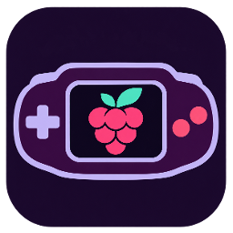
</p>

# BerryBoy Advance — 0.8.1 development

Game Boy Advance emulation for the BlackBerry Bold 9900 and BBOS 7.1, with
local games, save states, cheats and configurable controls. Desktop tools run
on **Linux, JDK 21 and Maven 3.9.x**.

[Changelog](CHANGELOG.md) · [Roadmap](docs/BENCHMARKS.md) ·
[BlackBerry setup](docs/BLACKBERRY.md)

## Phone interface

The BBOS frontend now opens local `.gba` files with a supplied 16 KiB BIOS and
provides a home screen, pause menu, file browser and configurable controls.

- **Save/load state:** five slots capture CPU work, RAM, PPU, audio, timers, DMA,
  cartridge state and scheduled hardware events. Version, ROM/BIOS identity and
  CRC checks reject incompatible or damaged files before replacing the session.
- **Cheats:** named, switchable Raw RAM writes and unencrypted CodeBreaker types
  3/8. Encrypted GameShark/Action Replay and other command types are not supported.
- **Controls:** remap all ten buttons; mappings and preferences persist.
- **Sound:** volume, mute and mono/stereo output, with a bounded MMAPI packet backend.
- **Display:** full-screen play with no app header or footer. Choose **Full screen**
  to preserve GBA proportions, **Stretch** for edge-to-edge output, or native/integer
  scaling. Optional frame skip affects presentation; FPS is a small overlay.

See [phone usage and storage](docs/BLACKBERRY.md#phone-interface).

## Golden Sun walkthrough

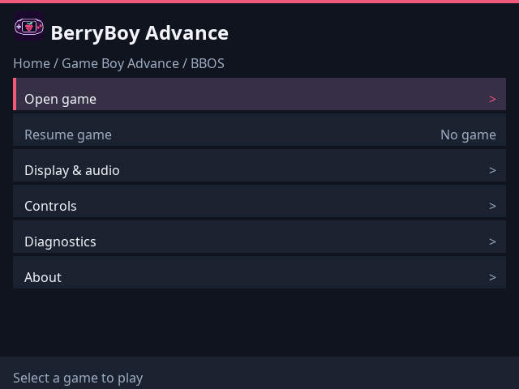

A 15-second walkthrough: Home, Golden Sun selection and ten seconds of real
emulation. The selection screen is illustrative; the game segment resumes a
recorded state and omits BIOS boot. [Recording details](docs/images/phone/golden-sun-walkthrough.json).

## Phone screenshots

Full-screen captures at **640×480**, rendered by the application.

| Metroid: Zero Mission | Grand Theft Auto Advance |
| --- | --- |
| 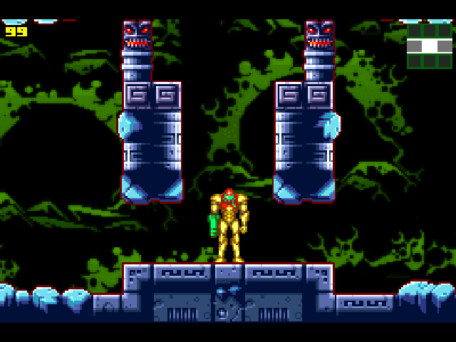 | 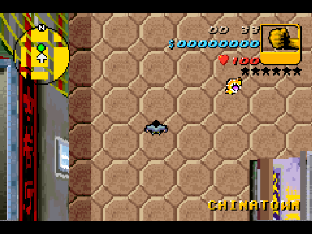 |
| Golden Sun: The Lost Age | Wario Land 4 |
| 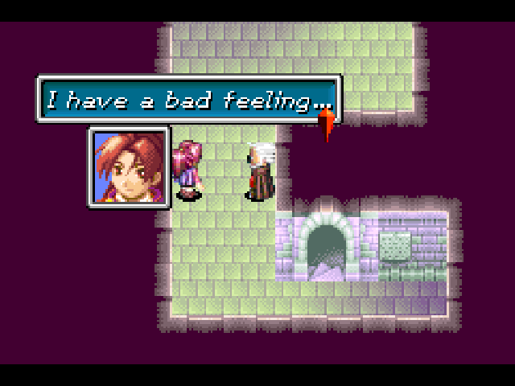 | 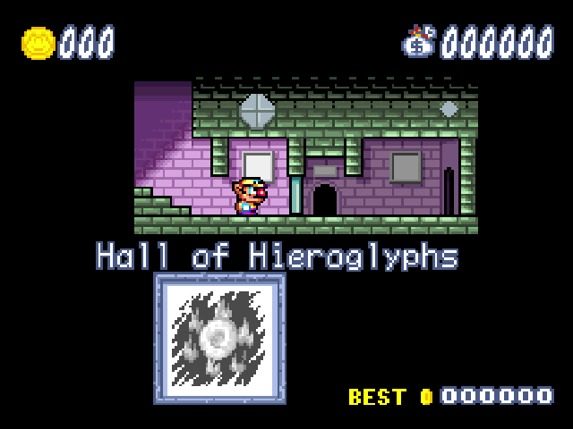 |

[V-Rally 3 — stage selection](docs/images/phone/v-rally-3.png)

### App screens

| Home | Pause menu |
| --- | --- |
| 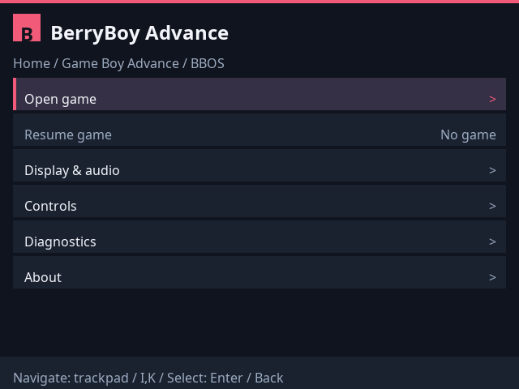 | 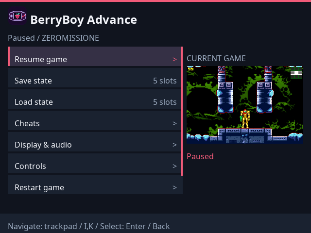 |
| Display and audio | Controls |
| 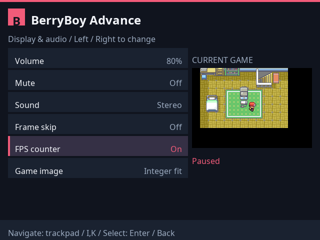 | 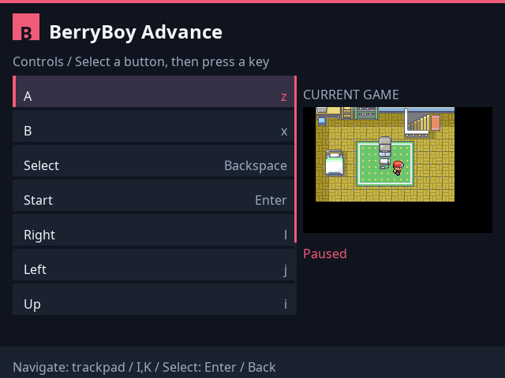 |

[Save slots](docs/images/phone/slots.png) ·
[Capture details](benchmarks/fullscreen-branding-2026-11-06.json)

## Build and run

Check `mvn -v`: Maven must use JDK 21 without preview features.

```bash
mvn verify
mvn compile exec:java                         # Original visual demo in a window
mvn compile exec:java -Dexec.args="demo --headless"
mvn compile exec:java -Dexec.args="audio-demo --headless"
```

The visual demo writes `target/demo.png` and `target/demo.gba`; the audio demo
writes a WAV file. Omit `--headless` from the audio command to request Java Sound
playback. The original visual demo is static and silent.

Inspect a cartridge header or run a direct-entry homebrew diagnostic:

```bash
mvn compile exec:java -Dexec.args="header /path/to/game.gba"
mvn compile exec:java -Dexec.args="run /path/to/homebrew.gba 200000 --headless"
```

Without `--headless`, `run` continues in the desktop window. Controls: **arrows**
for D-pad, **Z/X** for A/B, **A/S** for L/R, **Enter** for Start and **Backspace**
for Select. Simultaneous keys work; losing focus releases them.

The CLI diagnostic starts directly in the cartridge. Real-BIOS commercial-game
captures use local ROM/BIOS mappings and recorded input through
[ScenarioRunner](docs/SCENARIOS.md). Keep ROM, BIOS and save files outside Git.

## Tests and portability

```bash
mvn -Dgroups=core test
mvn -Dgroups=desktop test
mvn -Dgroups=build test
tools/test-with-console.sh
```

JUnit discovers the tests and AssertJ provides assertions. The console script
repeats core tests against exported classes without access to host core classes.
See [TESTING.md](docs/TESTING.md) for conventions and
[BENCHMARKS.md](docs/BENCHMARKS.md#current-validation) for current results and limits.

BBOS 7.1 cannot run Java 21 bytecode. `LegacyExport` generates restricted legacy
sources from the shared core; desktop/build packages are excluded. Export with:

```bash
mvn compile exec:java@legacy-export
```

The exporter supports a limited set of syntax transformations. Modern JDK APIs,
records, lambdas and collections are not automatically portable to the core.

## BlackBerry build

Build on Linux using JDE 7.1, ECJ 4.6.1 and the vendor RAPC:

```bash
export BB_JDE_HOME=/path/to/BlackBerry-JDE-7.1.0
export BB_ECJ_JAR=/path/to/ecj-4.6.1.jar
mvn -Pbb-sim verify -Dbb.compiler=ecj -Dbb.ecj="$BB_ECJ_JAR" -Dbb.launch=false
```

The output is `target/blackberry/output/BerryBoyAdvance.cod`, with the application
icon packaged in the MIDlet. The Wine/JDK 6 route and installation details are in
[BLACKBERRY.md](docs/BLACKBERRY.md).
The MIDlet starts at the phone home screen. Open a local game, or use
**Diagnostics** for the original demo and eight portable checks.

## Source organization

| Area | Responsibility |
| --- | --- |
| `berryboy.cpu` | ARM/Thumb decoding, state, ALU and exceptions |
| `berryboy.bus`, `berryboy.timing` | Memory, bus costs, DMA, events, timers and IRQ |
| `berryboy.video`, `berryboy.audio` | Software/raster PPU and clocked sound |
| `berryboy.cartridge`, `input`, `serial` | Backups, GPIO/RTC/sensors, keys and disconnected link hardware |
| `berryboy.state`, `MachineState` | Bounded state codec and complete machine-state orchestration |
| `berryboy.mobile`, `berryboy.cheat` | Portable phone UI/preferences, output policy and RAM cheats |
| `berryboy.desktop` | CLI, Swing, persistence and scenario capture |
| `berryboy.desktop.concurrent`, `capture` | Bounded host workers and owned snapshots |
| `berryboy.build`, `tools/` | Export, SDK builds, reference probes and capture tooling |
| `platform/midp/` | BlackBerry adapter |

Guest state stays on one deterministic emulation owner. Parallel host work uses
bounded snapshot queues for encoding and I/O. See [ARCHITECTURE.md](docs/ARCHITECTURE.md)
and [AGENTS.md](AGENTS.md) for design and delivery conventions.

## Desktop preview

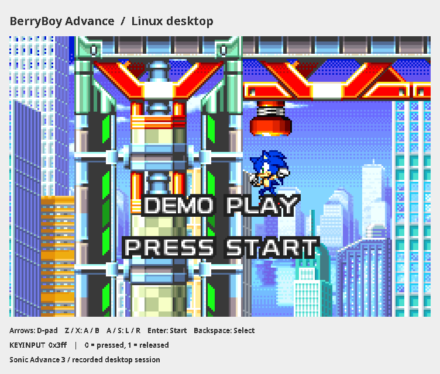

Sonic Advance 3, Metroid Fusion, Golden Sun and Pokémon LeafGreen, recorded from
real emulation into the production Swing view. This silent 12-second montage
samples every six guest frames; the GUI was painted headlessly. LeafGreen uses
a restored player save and recorded keyboard actions. It shows the desktop view and game output.
[Capture metadata](docs/images/desktop-games.json) ·
[Current status and roadmap](docs/BENCHMARKS.md) · [Changelog](CHANGELOG.md)

## Reproduce the GIF

After `mvn verify`, install Python Pillow and prepare local `<game-code>.properties`
files as described in [SCENARIOS.md](docs/SCENARIOS.md). Supply B3SE, AMTE, AGSE
and BPGE mappings matching [showcase.tsv](benchmarks/showcase.tsv). BPGE requires
the recorded continuation input and a matching initial player save; the other
clips start with fresh backups. Asset hashes are checked and save files are never written.

```bash
tools/capture-showcase.sh /path/to/local/scenarios target/desktop-games.gif
```

The script paints the application's `DesktopPanel`, then encodes its PNG frames
as a GIF with adjacent JSON provenance. The capture does not require a display server.

## Reproduce the phone screenshots

Build with `mvn verify`. The gallery manifest selects five local games and their
recorded inputs. Capture the required frame checkpoints, then render them through
the application's phone UI:

```bash
tools/capture-phone-gallery.sh /path/to/local/scenes target/phone-captures
```

`tools/CaptureGalleryScenes.java` creates those checkpoints from verified ROM/BIOS
mappings, the baseline input and the additional recordings in `benchmarks/inputs/`.
[phone-gallery.tsv](benchmarks/phone-gallery.tsv) defines the selected frames.
For a single saved state, `tools/capture-phone.sh` remains available.

Regenerate compact app/logo assets from the brand master with:

```bash
java -Djava.awt.headless=true tools/PrepareBrandAssets.java
```
