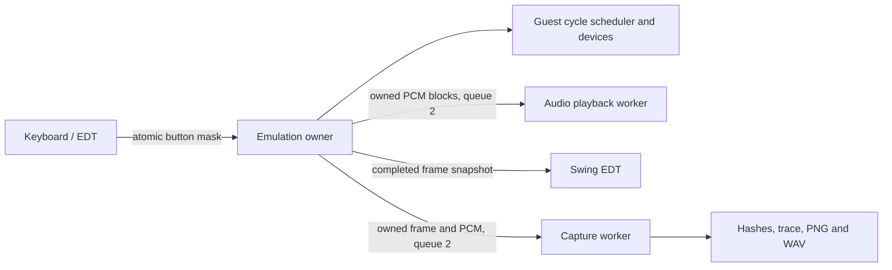

# Core architecture and scope

## Responsibilities

Production and test sources are grouped by feature: `cpu`, `bus`, `timing`,
`video`, `audio`, `cartridge`, `input` and `serial`. The `berryboy` root contains composition
and diagnostic entry points. Desktop and build tooling remain host-only.

CPU execution depends on the bus; devices do not call into CPU internals.
`VideoBus` gives the PPU read-only sampling/version access. `LcdListener` and
`TimerOverflowListener` route device events through bus wiring, avoiding a
video-to-DMA or timer-to-audio dependency. Decoder implementation classes remain
package-private. Register ports are public integration boundaries.

The legacy exporter recursively includes core packages, preserves relative
paths (including identical filenames in different packages), and excludes host
packages. Generated nested directories receive the same ownership, stale-file
and symlink checks as root files.

## Thread ownership and host pipelines

Guest CPU, DMA, timers, LCD and synthesis retain a single deterministic owner.
Device event order must not depend on host thread scheduling. Host operations
run concurrently through `desktop.concurrent.BoundedWorker`:

The desktop playback worker owns blocking Java Sound writes. Scenario captures
use a separate worker for hashing, encoding and disk IO, while emulation can
prepare subsequent frames. Workers receive deep copies, never a `Machine` or
live framebuffer. Queue capacity applies backpressure instead of dropping jobs.
Capture closure drains accepted work and joins before final hashes/reports are
read. Consumer errors wake blocked producers and fail the run; interrupts are
preserved during joining. Stopping the desktop closes the sound device before
joining playback so a blocked native write can finish.

Physical audio latency and Swing repaint coalescing still need measurement.
Parallel host output does not establish multicore CPU emulation or physical
A/V synchronization. Device APIs and all host concurrency stay out of the
portable BlackBerry export.

| Class | Responsibility |
| --- | --- |
| `Cpu` | Fetches instructions, chooses ARM/Thumb and adds failure diagnostics |
| `CpuState` | Stores registers and flags, switches banks and handles CPSR/SPSR |
| `ArmInterpreter` | Decodes ARM encodings and dispatches instruction families |
| `ThumbInterpreter` | Decodes and executes Thumb instruction families |
| `ArithmeticLogicUnit` | Calculates results and NZCV flags |
| `BarrelShifter` | Calculates shifts, rotations and carry-out |
| `InstructionInterpreter` | Shares unaligned-read, BX and SWI rules |
| `Keypad` | Stores the ten pressed-button bits and exposes active-low input |
| `AudioUnit`, `ClockedAudio` | Decode PSG/FIFO registers and produce cycle-driven stereo samples |

The decoders share one `CpuState` and one `Memory` bus. Their ALUs and shifters are
created during construction, with no per-instruction allocation on successful
execution. `Machine` and the public `Cpu` API provide the main integration points.
Operand names describe their roles, such as `destination`, `baseRegister` and
`registerList`; hardware abbreviations such as CPSR, SWI and ALU remain intact.

## CPU

The ARMv4T interpreter advances the shared guest clock for instruction/data bus
transfers, internal execution cycles and branch refills. `BusTiming` models
memory widths and WAITCNT waits; `InstructionTiming` models internal cycles.
Game Pak opcode prefetch has an eight-halfword buffer, fills during internal
cycles/off-cartridge data transfers and flushes on branches or cartridge data
access. The documented prefetch-disable N-cycle bug is modeled. Display-bus
contention and full pipeline overlap remain unverified. This is a timing foundation, not a claim of
hardware-cycle accuracy across games. Internally,
`r15` holds the next instruction address; operand reads add the pipeline offset.
ARM reads use PC+8, or PC+12 for register shifts and STR. Thumb reads use PC+4.

Supported instruction families:

- ARM: all 16 ALU operations, NZCV flags, conditions, the barrel shifter, B/BL/BX,
  byte/word LDR/STR, halfword and signed transfers, LDM/STM, SWP, MUL/MLA, long
  multiplication, MRS/MSR, register banks and basic SWI entry.
- Thumb: ARMv4T formats 1–19, including ALU operations, high registers, loads and
  stores, SP/PC-relative access, PUSH/POP, multiple transfers, branches and two-part BL.
- SWI requires a supplied BIOS through `Memory.setBios`; otherwise it reports an
  error. `MOVS pc,lr` restores SPSR on return. BIOS HLE is not implemented.

Instruction-family coverage does not imply full conformance. Empty register lists
and selected unpredictable operand combinations stop execution. MUL preserves C,
which ARMv4 defines as unpredictable. IRQ scheduling, aborts, undefined exceptions,
cycles, wait states and self-modifying pipeline behavior are not implemented.
ARMv5 and Thumb-2 are outside the target architecture.

## Memory bus

The bus provides 256 KiB EWRAM, 32 KiB IWRAM, 1 KiB palette RAM, 96 KiB VRAM,
1 KiB OAM and up to 32 MiB ROM. It implements RAM mirroring, the VRAM mirror at
`0x18000..0x1ffff` and three ROM windows. Unaligned LDR rotates the word;
LDRH/LDRSH follow the ARM7 behavior described in GBATEK. STR/STRH and block
transfers enforce alignment.

Byte writes to palette RAM and BG VRAM duplicate the byte across the halfword.
OAM and OBJ VRAM ignore byte stores. `KEYINPUT` is active-low and read-only.
DISPCNT, BG2CNT and the BG2 affine registers drive the renderer.

Unimplemented regions and I/O stop execution. SRAM/Flash/EEPROM and configurable
RTC/GPIO devices are implemented. BIOS data reads from outside BIOS retain the
last BIOS prefetch word. Unmapped CPU data reads expose ARM prefetch byte lanes
or Thumb instruction-bus layouts; unmapped CPU stores have no responding device.
Instruction fetches in unmapped regions still diagnose unsupported execution.
DMA open-bus latches,
self-modifying prefetch behavior and some cartridge timing details still need
qualification. ROM reads beyond the cartridge size return an address-derived pattern.

## Rendering

`BitmapRenderer` produces a BG2 snapshot in bitmap modes 3, 4 and 5. It handles
frame selection, palette lookup, backdrop color, forced blank and basic affine
transforms through BG2PA/B/C/D/X/Y. One RGB888 buffer is reused between renders.

CPU/scanline synchronization, VBlank, tiles, OBJ, blending, windows, mosaic and
bitmap wrapping are not implemented. Enabled unsupported effects report errors.
The demo writes the transform registers explicitly; the renderer does not supply
hidden defaults.

## Audio and input

`Memory` owns the keypad and audio unit. `Machine.audio` exposes the same audio
unit for platform adapters. Guest loads observe keypad updates through read-only
`KEYINPUT`; KEYCNT supports OR/AND chord matching and keypad IRQ requests.

The four PSG channels produce interleaved signed PCM16 at 32768 Hz: pulse with
sweep, pulse, banked wave RAM and 15/7-bit noise, with length/envelope controls
and independent stereo routing. `ClockedAudio` generates one sample every 512
guest cycles and optionally captures it in a bounded 8192-frame queue with
produced/consumed/overrun/underrun counters. `AudioUnit.render` remains an explicit
sample-advancing diagnostic API; live sinks must drain `ClockedAudio` instead of
advancing synthesis a second time. Direct Sound A/B latch signed FIFO bytes on
selected timer overflows, route independently to stereo and request four-word
DMA1/2 refills at the 16-byte threshold. The mixer saturates instead of wrapping.
PWM/BIAS effects and hardware sequencer edge cases remain open.

The shared scheduler drives LCD HBlank/VBlank/VCOUNT and four reloadable,
prescaled/cascaded timers. IE/IF/IME expose interrupt requests with write-one-to-
clear acknowledgement. CPU IRQ entry preserves CPSR/LR in the IRQ bank and
returns through the existing exception-return instructions. HALT waits for an
enabled interrupt request, independently of IME/CPSR.I; STOP remains unsupported.
`Machine(image, bios)` starts a supplied 16 KiB BIOS at the reset vector with
SVC/IRQ/FIQ reset state. Synthetic BIOS tests cover reset and IRQ return; eleven
uploaded games complete real-BIOS startup smoke captures (see
[GAME-COMPATIBILITY.md](GAME-COMPATIBILITY.md)). Four DMA channels latch source/destination/count on
enable and stop CPU execution while transferring. Immediate, visible HBlank and
VBlank triggers, channel priority, repeat, destination reload and completion
IRQs are supported. DMA yields to the host cycle-budget caller after each transfer
unit, retaining channel priority and CPU bus ownership until completion. Bus
costs advance LCD/timer events during transfers. Special
video-capture timing and Game Pak DRQ remain explicitly unsupported. DMA1/2
support sound FIFO timing with forced word width, fixed destination and count 4.
See [BENCHMARKS.md](BENCHMARKS.md) for the implementation order and measurement gate.

## Java and performance

`CartridgeBackup` models 32 KiB SRAM, 64/128 KiB Flash unlock/program/erase/ID/bank
commands and 512-byte/8 KiB serial EEPROM. ROM SDK signatures select the initial
type; EEPROM command DMA lengths resolve its address width. An explicit
`Memory.setBackup` overrides detection. Flash/EEPROM busy timing is not yet
modeled. Backup snapshots do not alias live storage. Desktop `SaveFile` validates
loaded sizes and replaces saves through a temporary file; platform adapters own
their persistence mechanism. `CartridgeGpio.configure` explicitly selects RTC,
solar, gyro, tilt and rumble hardware. Inputs can be supplied deterministically
with `setSensors`; conversion start latches gyro/tilt values. `CartridgeRtc`
implements serial control/date/time transfers, BCD and 12/24-hour mode, advancing
its calendar from guest cycles rather than host time. GPIO reads honor direction
and read-enable bits. RTC IRQ waveforms, sensor conversion latency/calibration
and physical rumble remain unverified. Peripheral selection and RTC seeding must
be recorded by scenario runners; no implicit host clock or game-specific hack
is used.

`SoftwarePpu` is the reference compositor behind the `BitmapRenderer` snapshot
adapter. It supports text/affine/bitmap BGs, OBJ/affine OBJ, priority/transparency,
windows/OBJ windows, mosaic and color effects. Device reads bypass CPU bus
accounting. `RasterPpu` samples visible pixels every four guest cycles, maintains
affine row references and publishes complete double-buffered frames. Palette and
affine reference changes affect subsequent samples instead of repainting the
whole frame. Snapshot rendering remains available for diagnostics. This logical
sampling model does not reproduce the LCD fetch pipeline. OBJ evaluation uses
the documented line-cycle budget (1210 or 954 with HBlank free), including
affine setup/pixel costs and offscreen objects; detailed fetch timing remains
qualification work.

Aligned halfword reads use direct RAM/video/cartridge paths, retaining the slow
path for unaligned reads, GPIO, IO and undriven ROM. Display-register caching is
invalidated by writes; VRAM and palette reads remain live. Raster tests verify
that register/palette writes still affect subsequent pixels.

The development project targets Java 21. The instruction execution path uses
primitives and arrays. Local `var` changes source syntax only; the exporter
resolves concrete types before generating the BlackBerry sources.

There is no ARM guest JIT or dynamic recompiler. ARM/Thumb instructions are
interpreted on the host JVM or interpreter. Desktop demo timing does not predict
frame rate or performance on a Bold device.

## Desktop layer

`LaunchCommand` parses arguments into `Demo`, `Header`, `Run` or `AudioDemo` records. A sealed
interface closes the command hierarchy, allowing `Main` to handle every variant
with Java 21 record patterns in a switch, without preview features.

The parser performs no file I/O or emulation. `Main` separates program execution,
PNG export, result presentation and Swing startup. `ExecutionResult` describes
the completed diagnostic run and its machine. The whole desktop package is
excluded from BlackBerry export.

`DesktopSession` owns that machine on one worker thread. `KeyboardInput` receives
Swing actions and publishes an atomic button mask; focus loss clears held keys.
The worker applies input, runs to absolute audio-cycle targets, drains clocked
PCM and passes completed raster frames to the event dispatch thread. Presentation applies backpressure
instead of accumulating frames in an unbounded queue. Swing can still coalesce
repaints; this is not a verified no-drop physical video pipeline.

`PcmAudio` owns Java Sound playback and WAV encoding. A missing audio device is
reported in the window and leaves the diagnostic session running silently.
`AudioDemo` configures the emulated registers to produce a reproducible tone.
`DesktopPanel` is shared by the real window and the headless documentation capture.

## Tests and diagnostics

JUnit Jupiter runs the tests; AssertJ supplies every host assertion. Both are
`test`-scope dependencies, excluded from the application JAR and generated core.
Surefire discovers `*Test` classes, and parameterized tests report each operand
and flag combination separately. `assertSoftly` groups related state checks.

`LegacyCoreTest` loads the generated core through a `URLClassLoader` with a
platform parent, preventing host core classes from replacing the generated
ones. The console script also repeats all tests tagged `core`, with only generated
production classes on its classpath. Host build and desktop tests are excluded
from that discovery pass, so the host core cannot conceal a missing exported class.

`RuntimeChecks` is portable application diagnostics for MIDP, independent of
JUnit and AssertJ. The old BlackBerry runtime cannot execute Jupiter.
`DemoRomTest` also runs those diagnostics on the host JVM.

## Source reading order

1. `Machine`: assembles the cartridge, memory, CPU and renderer.
2. `DemoRom`: contains actual guest instructions with assembly comments.
3. `Cpu.step`: selects the decoder and supplies failure diagnostics.
4. `ArmInterpreter.execute` and `ThumbInterpreter.execute`: select instruction families.
5. `ArithmeticLogicUnit` and `BarrelShifter`: calculate results and flags.
6. `LegacyExport`: coordinates AST reading, type resolution and source output.
   `LegacySyntaxScanner` collects edits before type analysis; `LegacyApiScanner`
   checks resolved methods after analysis. Records describe sources and edits.
7. `BlackBerryMidlet`: runs the shared classes in MIDP.

## References

- [ARM7TDMI Technical Reference Manual](https://documentation-service.arm.com/static/5f4786a179ff4c392c0ff819?token=)
- [GBATEK — preserved GBA documentation](https://rust-console.github.io/gbatek-gbaonly/)
- [Tonc — bitmap modes](https://gbadev.net/tonc/bitmaps.html)
- [Maven Compiler — release](https://maven.apache.org/plugins/maven-compiler-plugin/examples/set-compiler-release.html)

The code was written for this experiment and contains no third-party BIOS or commercial ROM.
