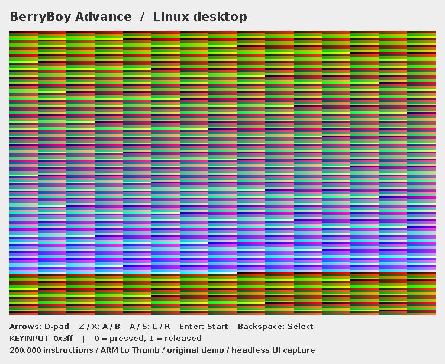
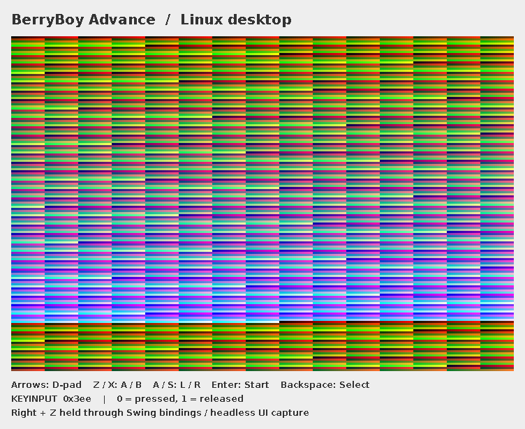

# Audio and controls

## Linux desktop

```bash
mvn verify
java -jar target/berryboy-advance-0.6.0-SNAPSHOT.jar demo
java -jar target/berryboy-advance-0.6.0-SNAPSHOT.jar run /path/to/homebrew.gba 200000
```

The initial instruction budget produces a diagnostic snapshot. An interactive
window then continues executing the same machine on a worker thread. Closing
the window stops that worker and closes its audio line. Guest faults stop the
session with a visible diagnostic.

| Keyboard | GBA button |
| --- | --- |
| Arrow keys | D-pad |
| Z / X | A / B |
| A / S | L / R |
| Enter | Start |
| Backspace | Select |

Buttons can be held together. Key repeat is idempotent. Losing window focus or
closing the session releases all buttons. Swing events update a thread-safe
input snapshot; only the emulation worker writes to the memory bus. `KEYINPUT`
is active-low and read-only from guest code. Keypad interrupts remain pending.

The original demo draws a fixed pattern and ends in a loop. Its image does not
react to buttons and it does not enable audio. The footer displays the actual
`KEYINPUT` value, and input-aware homebrew can read the register.

## Audio diagnostic

```bash
java -jar target/berryboy-advance-0.6.0-SNAPSHOT.jar audio-demo
java -jar target/berryboy-advance-0.6.0-SNAPSHOT.jar audio-demo --headless
```

Both commands create `target/audio-demo.wav`: one second of stereo PCM16 at
32768 Hz, beginning with an approximately 440 Hz channel-2 tone that fades to
silence. The first command also opens a Java Sound output device. The headless
command needs no sound card. If a device is unavailable, the WAV remains usable
and the desktop emulator continues silently with a visible status.

`AudioUnit` owns the supported sound registers and stereo mixer. `PulseChannel`
owns the oscillator, duty, envelope, length and restart behavior. Both are
exported with the portable core. `PcmAudio` handles the host device and WAV
encoding; no Java Sound API enters the BlackBerry export.

| Capability | Status |
| --- | --- |
| Channel 2 pulse, four duty cycles, frequency and restart | Implemented and regression-tested |
| Channel 2 length, volume envelope and DAC disable | Implemented and regression-tested |
| Stereo routing and PSG volume ratio | Implemented and regression-tested |
| Channels 1, 3 and 4; Direct Sound A/B, FIFOs and timer/DMA feed | Implemented with focused synthetic regressions |
| SOUNDBIAS register storage | Implemented; PWM and bias effects are not modeled |
| CPU-cycle synchronization | Implemented: one PCM frame per 512 guest cycles |
| Hardware sequencer edge cases | Pending hardware/reference qualification |
| Actual listening test, device latency and underrun measurements | Not verified in this environment |

`ClockedAudio` advances synthesis on guest-cycle deadlines. The desktop uses
absolute cycle targets for PCM blocks and drains the bounded queue, reporting
underruns/overruns explicitly. It presents completed raster frames and rejects
missing guest frames between batches. `AudioUnit.render` is a separate diagnostic
API that advances by the requested samples. Swing applies backpressure but can
coalesce repaints; physical presentation, stable game FPS and audible A/V sync
still require measurement. No deliberate frame-skip option is present.

## BlackBerry adapter

The MIDlet forwards QWERTY Z/X, A/S, Enter/Backspace and MIDP direction/FIRE
events to the shared keypad. It clears held input on hiding, pausing or exit,
continues the demo loop, and can rerun portable checks. Key codes still need
validation on the actual Bold 9900 simulator/device.

The shared sound generator is exported. A BlackBerry audio-output adapter is
still pending. Desktop Java Sound output does not establish phone playback.

## Application captures

These images are the production `DesktopPanel`, painted headlessly using the
real demo framebuffer. They are not simulator captures, physical-monitor
captures or evidence of commercial-game compatibility.



The second capture dispatches Right and Z through the real Swing action map.
`KEYINPUT` changes from `0x3ff` to `0x3ee`.



Regenerate from the project root on JDK 21:

```bash
mvn compile
tools/capture-docs.sh
# For a temporary capture that does not replace tracked documentation:
tools/capture-docs.sh target/documentation-captures
```

## References

- [GBATEK sound registers and channel definitions](https://mgba-emu.github.io/gbatek/#gba-sound-controller)
- [Java 21 SourceDataLine](https://docs.oracle.com/en/java/javase/21/docs/api/java.desktop/javax/sound/sampled/SourceDataLine.html)
